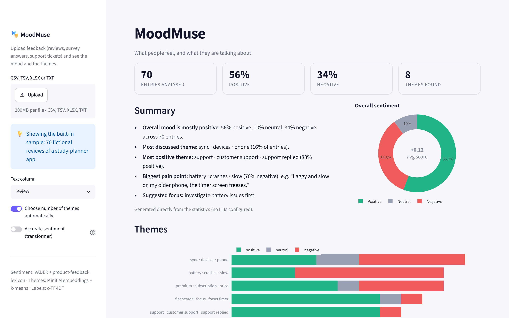
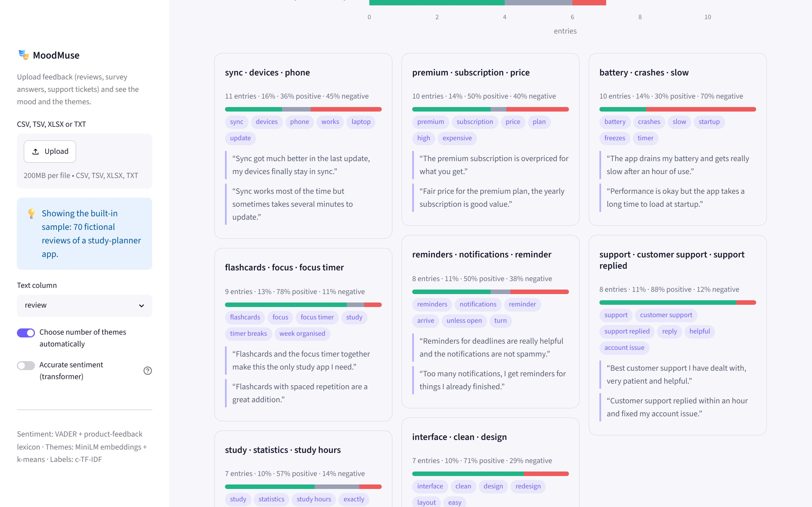

<div align="center">

# 🎭 MoodMuse

**Drop in a pile of written feedback (reviews, survey answers, support tickets) and see what people feel and what they're talking about.**

[](https://github.com/Mahima1810/moodmuse/actions/workflows/ci.yml)




</div>

## What it does

| Step | How |
|---|---|
| **Clean** | Reads CSV / TSV / XLSX / TXT, guesses the text column, normalises whitespace, drops empty, very short and duplicate entries |
| **Sentiment** | VADER plus a product-feedback lexicon ("crashes", "laggy", "overpriced"…) by default; an optional RoBERTa transformer is more accurate |
| **Themes** | Sentence embeddings (all-MiniLM-L6-v2), then k-means, with k chosen automatically by silhouette score. Falls back to TF-IDF + SVD when offline |
| **Theme labels** | Class-based TF-IDF (c-TF-IDF): words common in one theme but rare in the others |
| **Summary** | An LLM (any OpenAI-compatible API) writes bullets **only from the computed statistics and real quotes**. Without one, a template summary is built from the numbers |
| **Explore** | Streamlit dashboard: KPIs, sentiment donut, sentiment-by-theme bars, theme cards with representative quotes, a 2-D "feedback map", a filterable table, and CSV / Markdown downloads |



## Quick start

```bash
git clone https://github.com/Mahima1810/moodmuse.git
cd moodmuse
python -m venv .venv && source .venv/bin/activate   # Windows: .venv\Scripts\activate
pip install -r requirements.txt
streamlit run app.py
```

The dashboard opens with a built-in sample (70 **fictional** reviews of a study-planner app). Upload your own file from the sidebar.

The first run downloads the small embedding model (~90 MB).

### Command line

```bash
python -m moodmuse data/sample_reviews.csv --column review --out report.md --csv results.csv
python -m moodmuse feedback.txt --k 5 --themes tfidf      # fixed 5 themes, no model download
```

### Optional: LLM-written summary

Set `LLM_MODEL`, `LLM_BASE_URL` and `LLM_API_KEY` (see `.env.example`). This works with OpenAI, Groq, OpenRouter or a local Ollama (`http://localhost:11434/v1`). If the call fails, MoodMuse falls back to the template summary.

### Docker

```bash
docker build -t moodmuse .
docker run -p 8501:8501 moodmuse
```

## How accurate is it?

`scripts/evaluate_sentiment.py` compares predicted sentiment with the star ratings in the sample data (4–5 stars = positive, 3 = neutral, 1–2 = negative):

| Sentiment backend | 3-class accuracy | Accuracy on 1–2 and 4–5 star reviews |
|---|---|---|
| VADER (stock) | 55.7% | 62.3% |
| VADER + product-feedback lexicon (default) | 74.3% | 83.6% |
| RoBERTa transformer (`cardiffnlp/twitter-roberta-base-sentiment-latest`) | **91.4%** | **95.1%** |

**Please read these numbers with care:**
- The sample has only 70 reviews, and I wrote them myself for the demo, so this is a sanity check, not a benchmark.
- The lexicon words are general product-feedback terms, but they were chosen while looking at this sample, so the VADER + lexicon number is likely optimistic.
- Star ratings are a noisy label: a 3-star review is often clearly negative.

If you want an independent number, a good first contribution is evaluating on a public labelled dataset (for example Amazon or Yelp reviews).

## Tests

```bash
pip install -r requirements-dev.txt
pytest        # 18 tests: cleaning, sentiment, themes, pipeline, LLM fallback, CLI
ruff check .
```

The tests use TF-IDF themes and VADER, so they run offline and fast.

## Limitations

- Feedback must be in English. VADER and MiniLM are English models.
- k-means gives every entry exactly one theme. An entry about both price and crashes is put in only one of them.
- Theme labels are keyword lists, not written names, unless you add an LLM step.
- Sarcasm ("great, another crash") still fools the lexicon backend. The transformer handles it better.

## Roadmap: good first contributions

- [ ] Evaluate on a public labelled review dataset and report the results
- [ ] Multilingual support (multilingual embeddings + XLM-R sentiment), including Indian languages
- [ ] LLM-written theme names, grounded in each theme's quotes
- [ ] Sentiment over time when a date column is present
- [ ] Aspect-based sentiment (price vs. performance inside one review)
- [ ] HDBSCAN option for "noise"-aware clustering

## Contributing

Contributions are welcome! See [CONTRIBUTING.md](CONTRIBUTING.md).

## About

Built in November 2026 by [Mahima Kopalley](https://github.com/Mahima1810) with AI-assisted development (Claude). Design decisions, evaluation and review are my own; issues and pull requests are welcome.

## License

[MIT](LICENSE)
